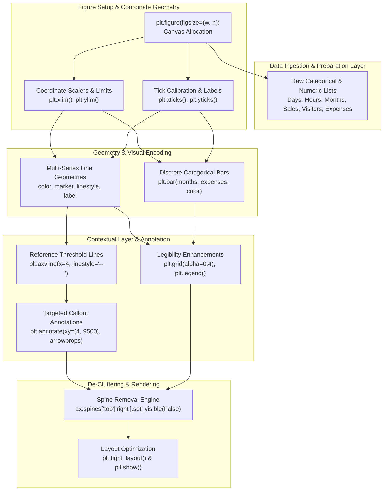

# 📊 Python Data Visualization & Visual Storytelling Lab: Matplotlib Chart Engineering (Quiz 05)

<div align="center">

[](https://colab.research.google.com/github/islamyasser424-design/Python-Quiz-05/blob/main/Python_Quiz_05.ipynb)
[](https://www.python.org/)
[](https://matplotlib.org/)
[](https://jupyter.org/)
[]()
[]()
[](LICENSE)
[](https://islamyasser424-design.github.io/portfolio-/)

<p align="center">
  <strong>An applied Python data visualization laboratory and technical assessment focusing on Matplotlib figure customization, multi-series time-series benchmarking, custom axis tick formatting, event-driven annotations, and minimalist corporate chart design following Edward Tufte's data-to-ink ratio principles.</strong>
</p>

[**🚀 Open Directly in Google Colab**](https://colab.research.google.com/github/islamyasser424-design/Python-Quiz-05/blob/main/Python_Quiz_05.ipynb) • [**📊 Explore Case Studies**](#-comprehensive-case-study-inventory--solutions) • [**📖 الدليل باللغة العربية**](#-الدليل-التحليلي-والتشغيلي-الشامل-باللغة-العربية)

</div>

---

## 📑 Table of Contents
- [Executive Overview & Visual Storytelling Philosophy](#-executive-overview--visual-storytelling-philosophy)
- [Curriculum & Visual Technique Matrix](#-curriculum--visual-technique-matrix)
- [System Architecture & Visualization Workflow](#-system-architecture--visualization-workflow)
- [Comprehensive Case Study Inventory & Solutions](#-comprehensive-case-study-inventory--solutions)
  - [Case Study 1: Weekly Multi-Branch Coffee Shop Sales Benchmarking](#case-study-1-weekly-multi-branch-coffee-shop-sales-benchmarking)
  - [Case Study 2: Daily Smartphone Battery Degradation & Power Efficiency](#case-study-2-daily-smartphone-battery-degradation--power-efficiency)
  - [Case Study 3: Monthly Website Traffic Surge & Event Annotation](#case-study-3-monthly-website-traffic-surge--event-annotation)
  - [Case Study 4: Monthly Store Expenses & Minimalist Spine De-Cluttering](#case-study-4-monthly-store-expenses--minimalist-spine-de-cluttering)
- [Information Design Principles & Cognitive Load Reduction](#-information-design-principles--cognitive-load-reduction)
- [Repository Structure](#-repository-structure)
- [Getting Started & Google Colab Execution](#-getting-started--google-colab-execution)
- [الدليل التحليلي والتشغيلي الشامل (باللغة العربية)](#-الدليل-التحليلي-والتشغيلي-الشامل-باللغة-العربية)
- [Author & Professional Connect](#-author--professional-connect)

---

## 📌 Executive Overview & Visual Storytelling Philosophy

In executive analytics, exploratory models and numeric aggregations only deliver business value when translated into intuitive, actionable visual narratives. Default charting libraries frequently introduce **visual clutter (chartjunk)**—excessive borders, dense unformatted numbers, and poor color contrasts that obscure the underlying signal.

This laboratory (**Python-Quiz-05**) systematically evaluates four core milestones in production-grade visual engineering using **Python** and **Matplotlib**:
1. **Multi-Series Comparative Trajectories**: Layering independent business metrics with differentiated line geometries (`linestyle`), marker topologies (`marker`), and categorical legends.
2. **Axis Calibration & Humanized Typography**: Replacing raw integer timestamps with 12-hour AM/PM categorical tick labels and defining strict scale boundaries (`xlim`, `ylim`) to eliminate optical distortion.
3. **Event Attribution & Targeted Annotations**: Anchoring vertical reference markers (`axvline`) and arrow-guided callouts (`annotate`) to connect external interventions (e.g., marketing campaign launches) to KPI surges.
4. **Minimalist Corporate Aesthetics (Tufte's Data-to-Ink Ratio)**: Stripping non-essential boundary borders (`spines['top']`, `spines['right']`) to maximize cognitive focus on data variance.

---

## 🎯 Curriculum & Visual Technique Matrix

| Case Study | Target Business Domain | Primary Chart Type | Key Matplotlib Capabilities Evaluated | Design Objective |
| :--- | :--- | :--- | :--- | :--- |
| **01** | **Retail Coffee Chain** | Multi-Line Plot | `plt.plot()`, `linestyle`, `marker`, `grid(True)`, `legend()` | Comparative branch trend evaluation over a 5-day cycle |
| **02** | **Hardware Tech Review** | Continuous Time-Series | `xlim()`, `ylim()`, `xticks()`, `yticks()`, `alpha=0.4` | Tracking non-linear battery depletion with humanized hours |
| **03** | **Digital Web Analytics** | Event-Annotated Line | `axvline()`, `annotate()`, `arrowprops`, `legend()` | Correlating a paid campaign launch with traffic inflection |
| **04** | **Financial Cost Auditing** | Discrete Column Bar | `plt.bar()`, `plt.gca()`, `spines['top'].set_visible(False)` | Modern corporate reporting with zero chartjunk borders |

---

## 🏛️ System Architecture & Visualization Workflow

The following Mermaid architectural diagram visualizes the data transformations, parameter configurations, and rendering pipeline implemented across all four case studies:



---

## 🧪 Comprehensive Case Study Inventory & Solutions

---

### Case Study 1: Weekly Multi-Branch Coffee Shop Sales Benchmarking

#### Business Context & Objective
A regional coffee chain operations manager needs to evaluate daily revenue performance between two flagship retail branches (**Branch A** vs. **Branch B**) over a standard 5-day operational work week (Sunday through Thursday). The objective is to identify volume disparities, assess mid-week momentum, and benchmark end-of-week sales surges.

#### Technical Implementation
```python
import matplotlib.pyplot as plt

# 1. Operational Dataset
days = ['Sunday', 'Monday', 'Tuesday', 'Wednesday', 'Thursday']
branch_a_sales = [120, 150, 130, 170, 200]
branch_b_sales = [90, 110, 105, 140, 180]

# 2. Canvas Setup
plt.figure(figsize=(9, 5))

# 3. Dual-Series Line Plotting with Visual Encoding
# Branch A: Solid blue line with circular data points
plt.plot(days, branch_a_sales, color='blue', marker='o', linestyle='-', label='Branch A')

# Branch B: Dashed green line with square data points
plt.plot(days, branch_b_sales, color='green', marker='s', linestyle='--', label='Branch B')

# 4. Canvas Styling & Legends
plt.title('Weekly Coffee Shop Sales')
plt.xlabel('Day')
plt.ylabel('Sales')
plt.grid(True)
plt.legend()
plt.tight_layout()

# 5. Display Plot
plt.show()
```

#### Visual Parameter & Design Breakdown
| Parameter | Value | Analytical Rationale |
| :--- | :--- | :--- |
| `figsize=(9, 5)` | $9 	imes 5$ inches | Provides sufficient horizontal canvas width for 5 discrete daily labels without text collisions |
| `color` | `'blue'` vs. `'green'` | Employs high-contrast chromatic distinction separating primary and secondary operational branches |
| `marker` | `'o'` (Circle) vs. `'s'` (Square) | Ensures data points remain clearly distinguishable even in monochrome or printed greyscale copies |
| `linestyle` | `'-'` (Solid) vs. `'--'` (Dashed) | Reinforces structural visual hierarchy between baseline and challenger retail branches |
| `plt.grid(True)` | Default enabled | Establishes immediate horizontal and vertical coordinate reference planes for quick value reading |

#### Analytical Business Insights
* **Branch A Dominance**: Branch A consistently outperformed Branch B across all 5 operational days, maintaining an average daily lead of $+27$ units.
* **Mid-Week Dip**: Both branches experienced a slight deceleration on Tuesday (Branch A: $150 
ightarrow 130$, Branch B: $110 
ightarrow 105$) before accelerating into the weekend.
* **Peak Volume (Thursday)**: Both locations recorded peak weekly sales on Thursday (Branch A: $200$, Branch B: $180$), indicating heightened consumer demand preceding the weekend.

---

### Case Study 2: Daily Smartphone Battery Degradation & Power Efficiency

#### Business Context & Objective
A hardware quality assurance team and technology reviewer conducted an endurance benchmark on a flagship smartphone. The test tracked battery percentage decay across 12 consecutive hours (from 9:00 AM to 9:00 PM) during intensive real-world usage (mixed browsing, video rendering, and GPS navigation).

#### Technical Implementation
```python
import matplotlib.pyplot as plt

# 1. Experimental Time-Series Data
hours = [9, 11, 13, 15, 17, 19, 21]
battery_level = [100, 85, 65, 45, 30, 15, 2]

# 2. Canvas Setup
plt.figure(figsize=(9, 5))

# 3. Line Trajectory Plotting
plt.plot(hours, battery_level, marker='o', color='orange')

# 4. Typography & Title
plt.title('Smartphone Battery Level')
plt.xlabel('Time')
plt.ylabel('Battery (%)')

# 5. Calibrated Coordinate Limits
plt.xlim(9, 21)
plt.ylim(0, 100)

# 6. Humanized Tick Customization
plt.xticks(hours, ['9 AM', '11 AM', '1 PM', '3 PM', '5 PM', '7 PM', '9 PM'])
plt.yticks(range(0, 101, 10))

# 7. Subdued Grid Aesthetics & Layout
plt.grid(True, linestyle='--', alpha=0.4)
plt.tight_layout()
plt.show()
```

#### Visual Parameter & Design Breakdown
| Parameter | Value | Analytical Rationale |
| :--- | :--- | :--- |
| `plt.xlim(9, 21)` | $[9, 21]$ | Binds the horizontal span strictly to the test window, eliminating empty margin padding |
| `plt.ylim(0, 100)` | $[0, 100]$ | Normalizes the vertical axis to an authentic percentage scale ($0\%$ to $100\%$) preventing misleading slope steepness |
| `plt.xticks(...)` | `['9 AM', ..., '9 PM']` | Translates raw 24-hour military integers into intuitive, human-friendly 12-hour AM/PM business notations |
| `plt.yticks(range(0, 101, 10))` | Step $= 10$ | Establishes uniform $10\%$ interval lines facilitating rapid mental interpolation of remaining charge |
| `alpha=0.4` | $40\%$ opacity | Subdues background grid intensity so grid lines guide the eye without competing with the data trend |

#### Analytical Business Insights
* **Steady Discharge Rate**: The device exhibited a near-linear discharge curve from 9 AM ($100\%$) to 7 PM ($15\%$), losing approximately $8.5\%$ battery per hour.
* **Critical Threshold Breach**: Battery dropped below the critical $20\%$ threshold between 5 PM and 7 PM, requiring immediate low-power mode activation.
* **Terminal Depletion**: By 9 PM, the device reached $2\%$ capacity, verifying a total battery lifespan of approximately $12$ continuous active hours.

---

### Case Study 3: Monthly Website Traffic Surge & Event Annotation

#### Business Context & Objective
A digital growth marketing agency tracked monthly unique visitor traffic across a 6-month evaluation period (January to June). In May, the agency executed a major multi-channel paid acquisition campaign. The visualization must explicitly correlate this specific marketing milestone with the resulting traffic inflection point using contextual annotations.

#### Technical Implementation
```python
import matplotlib.pyplot as plt

# 1. Monthly Visitor Metrics
months = ['Jan', 'Feb', 'Mar', 'Apr', 'May', 'Jun']
visitors = [5000, 5300, 4800, 6000, 9500, 8800]

# 2. Canvas Setup
plt.figure(figsize=(9, 5))
plt.plot(months, visitors, marker='o', color='#1f77b4', linewidth=2)

# 3. Vertical Event Threshold Line (May is at index 4)
plt.axvline(x=4, color='red', linestyle='--', label='Campaign launch')

# 4. Contextual Text Callout with Vector Pointer
plt.annotate(
    'Peak visits', 
    xy=(4, 9500), 
    xytext=(2, 10500),
    arrowprops=dict(arrowstyle='->', color='black', lw=1.2),
    fontsize=10,
    fontweight='semibold'
)

# 5. Axis Boundary & Framing
plt.ylim(0, 12000)
plt.title('Monthly Website Traffic')
plt.xlabel('Month')
plt.ylabel('Visitors')
plt.legend(loc='upper left')
plt.tight_layout()
plt.show()
```

#### Visual Parameter & Design Breakdown
| Parameter | Value | Analytical Rationale |
| :--- | :--- | :--- |
| `plt.axvline(x=4, ...)` | `x=4`, `color='red'`, `linestyle='--'` | Highlights the exact chronological intervention date across the entire vertical dimension |
| `plt.annotate(...)` | `xy=(4, 9500)`, `xytext=(2, 10500)` | Anchors a text narrative directly to the inflection vertex while positioning the text in negative canvas space |
| `arrowprops=dict(...)` | `arrowstyle='->'` | Draws an unequivocal visual vector guiding the viewer's cognitive attention to the peak data point |
| `plt.ylim(0, 12000)` | $[0, 12000]$ | Leaves headroom above $9,500$ to accommodate the callout label without overlapping chart borders |

#### Analytical Business Insights
* **Pre-Campaign Baseline**: Q1 traffic hovered in a narrow band between $4,800$ and $5,300$ visitors/month.
* **Campaign Impact ($+58.3\%$)**: The May campaign catalyzed a surge from $6,000$ (April) to $9,500$ (May), representing a dramatic $+58.3\%$ month-over-month increase.
* **Post-Campaign Retention**: While June experienced natural tapering ($8,800$), baseline traffic remained $+46.7\%$ above pre-campaign levels, proving strong sustained brand recall.

---

### Case Study 4: Monthly Store Expenses & Minimalist Spine De-Cluttering

#### Business Context & Objective
A corporate financial auditor and controller needs to present monthly operational overhead expenses (January through May) to executive leadership. In adherence to modern financial reporting standards and Edward Tufte's minimalism doctrine, the visual eliminates visual distraction ("chartjunk") by stripping redundant top and right bounding box borders.

#### Technical Implementation
```python
import matplotlib.pyplot as plt

# 1. Financial Overhead Dataset
months = ['Jan', 'Feb', 'Mar', 'Apr', 'May']
expenses = [3000, 4500, 3800, 5200, 4100]

# 2. Canvas Setup
plt.figure(figsize=(8, 5))

# 3. Discrete Column Bar Chart
plt.bar(months, expenses, color='red', width=0.6)

# 4. Semantic Titles & Axis Labels
plt.title('Monthly Store Expenses')
plt.xlabel('Month')
plt.ylabel('Expenses ($)')

# 5. Advanced Spine De-Cluttering (Chartjunk Removal)
ax = plt.gca()
ax.spines['top'].set_visible(False)
ax.spines['right'].set_visible(False)

# 6. Layout Finalization
plt.tight_layout()
plt.show()
```

#### Visual Parameter & Design Breakdown
| Parameter | Value | Analytical Rationale |
| :--- | :--- | :--- |
| `plt.bar(..., width=0.6)` | Column bars | Ideal geometry for discrete, non-continuous categorical metrics (monthly budget buckets) |
| `ax = plt.gca()` | Current Axes instance | Fetches the active axes object required for low-level structural manipulation |
| `spines['top'].set_visible(False)` | `False` | Deletes the extraneous top ceiling border that carries zero quantitative information |
| `spines['right'].set_visible(False)` | `False` | Deletes the redundant right border, opening the chart canvas and maximizing the data-to-ink ratio |

#### Analytical Business Insights
* **Expense Ceiling (April)**: April recorded the highest operational spend at $\$5,200$, requiring granular line-item auditing into seasonal utility or inventory costs.
* **Expense Floor (January)**: January had the lowest operational overhead at $\$3,000$.
* **Average Monthly Run-Rate**: Mean expenditure stood at $\$4,120$ per month, establishing a baseline benchmark for subsequent budget forecasting.

---

## 🎨 Information Design Principles & Cognitive Load Reduction

The visualizations in this project adhere to established human-computer interaction and visual analytics heuristics:

1. **Edward Tufte's Data-to-Ink Ratio**:
   $$\text{Data-to-Ink Ratio} = \frac{\text{Data-Ink}}{\text{Total Ink Used to Print the Graphic}}$$
   By turning off unnecessary spines (`ax.spines['top']` & `ax.spines['right']`) and reducing grid alpha (`alpha=0.4`), every pixel rendered serves an informational purpose.

2. **Preattentive Visual Attributes**:
   - Color is used functionally (e.g., bright red dashed lines for external interventions, distinct marker shapes for separate branches).
   - Marker typography (`'o'` vs. `'s'`) guarantees that charts remain legible for color-blind stakeholders or in black-and-white printouts.

3. **Cognitive Ease in Axis Design**:
   - Raw military timestamps ($9, 11, ..., 21$) are translated directly into business vernacular ($9\text{ AM}, 11\text{ AM}, ..., 9\text{ PM}$) so readers do not have to perform mental conversions.

---

## 📁 Repository Structure

```plaintext
Python-Quiz-05/
├── .gitignore              # Standard Python, Jupyter Notebook, virtualenv & OS ignore rules
├── LICENSE                 # MIT License (2026 Islam Yasser)
├── Python_Quiz_05.ipynb    # Primary Jupyter Notebook containing all 4 executed case studies
└── README.md               # Executive bilingual documentation & visual design guide
```

---

## 🚀 Getting Started & Google Colab Execution

### Run in the Cloud (1-Click)
Launch and interact with the notebook directly in your browser without local Python installation:
[](https://colab.research.google.com/github/islamyasser424-design/Python-Quiz-05/blob/main/Python_Quiz_05.ipynb)

### Run Locally

1. **Clone the Repository**:
   ```bash
   git clone https://github.com/islamyasser424-design/Python-Quiz-05.git
   cd Python-Quiz-05
   ```

2. **Create and Activate a Virtual Environment**:
   ```bash
   # Windows (PowerShell)
   python -m venv venv
   .\venv\Scripts\Activate.ps1

   # Linux / macOS
   python3 -m venv venv
   source venv/bin/activate
   ```

3. **Install Required Packages**:
   ```bash
   pip install matplotlib jupyterlab
   ```

4. **Launch Jupyter Lab**:
   ```bash
   jupyter lab Python_Quiz_05.ipynb
   ```

---

## 📖 الدليل التحليلي والتشغيلي الشامل (باللغة العربية)

### ما هو مشروع Python-Quiz-05؟
يمثل هذا المستودع دليلاً عملياً وتطبيقياً متقدماً على تقنيات **تصميم الرسوم البيانية وهندسة السرد القصصي للبيانات (Data Visualization & Visual Storytelling)** باستخدام لغة بايثون ومكتبة **Matplotlib**. يهدف المشروع إلى تدريب محلل البيانات على تجاوز الإعدادات الافتراضية للرسوم، وتحويل المخططات الرقمية الجافة إلى لوحات بصرية تنفيذية واضحة ومقنعة لأصحاب القرار في بيئات العمل الحقيقية.

---

### الحالات الدراسية الأربعة بالتفصيل:

#### 1. المقارنة الأسبوعية لمبيعات فروع المقاهي (`Multi-Branch Sales Benchmarking`):
* **الهدف التحليلي:** مقارنة أداء فرعين تجاريين (Branch A مقابل Branch B) على مدار 5 أيام عمل (من الأحد إلى الخميس).
* **التقنيات المستخدمة:**
  - رسم خطين بيانيين متعددي السلاسل على نفس اللوحة (`plt.plot`).
  - تمييز الفرع الأول بخط أزرق متصل وعلامات دائرية (`marker='o'`)، والفرع الثاني بخط أخضر متقطع وعلامات مربعة (`marker='s'`) لضمان وضوح الرسم حتى لو طُبع باللونين الأبيض والأسود.
  - إضافة شبكة الإحداثيات (`plt.grid`) وصندوق التعريف بالرموز (`plt.legend`) لتسهيل القراءة الفورية.

#### 2. تتبع استهلاك بطارية الهاتف المحمول ومعدل الكفاءة (`Battery Degradation Tracking`):
* **الهدف التحليلي:** تقييم كفاءة استهلاك الطاقة لهاتف ذكي على مدار 12 ساعة متواصلة (من 9 صباحاً حتى 9 مساءً).
* **التقنيات المستخدمة:**
  - ضبط حدود المحاور بدقة (`plt.xlim` و `plt.ylim`) لتمثيل النسبة المئوية من 0 إلى 100% ومنع التشويه البصري لميل الخط.
  - تحويل الأرقام الحسابية البحتة للساعات إلى تسميات وقت بشرية مريحة للعين (`9 AM`, `11 AM`, `1 PM` إلخ).
  - ضبط تدرج المحور الرأسي بمعدل 10% لكل خطوة (`range(0, 101, 10)`).
  - تخفيف شفافية خطوط الشبكة (`alpha=0.4`) لتعمل كدليل بصري خفيف دون التشويش على المنحنى البياني.

#### 3. نمو زيارات الموقع وربطها بإطلاق الحملة التسويقية (`Traffic Surge & Event Annotation`):
* **الهدف التحليلي:** إبراز التأثير المباشر لحملة تسويقية كبرى أُطلقت في شهر مايو وأدت إلى قفزة تاريخية في عدد زوار الموقع.
* **التقنيات المستخدمة:**
  - رسم خط مرجعي رأسي متقطع باللون الأحمر (`plt.axvline`) عند شهر مايو (الموقع 4) لتوضيح لحظة التدخل الخارجي بدقة.
  - استخدام أداة التوضيح الموجهة بسهم (`plt.annotate` مع `arrowprops`) للإشارة إلى قمة الزيارات (Peak visits = 9,500 زائر) في الفراغ المناسب من الرسم.
  - توسيع سقف المحور الرأسي إلى 12,000 لترك مساحة كافية للنص دون تداخله مع حدود الرسم.

#### 4. تحليل النفقات الشهرية وتقليص الهدر البصري (`Minimalist Spine De-Cluttering`):
* **الهدف التحليلي:** إعداد تقرير مالي لمديري الحسابات يوضح النفقات التشغيلية للمتجر عبر أعمدة بيانية رأسية بمظهر عصري هادئ.
* **التقنيات المستخدمة:**
  - رسم أعمدة رأسية (`plt.bar`) تمثل كل شهر بلون أحمر وعرض منضبط.
  - تطبيق مبدأ إدوارد تفتي (Edward Tufte) لتعظيم نسبة البيانات إلى الحبر (Data-to-Ink Ratio).
  - إخفاء الإطارات غير الضرورية العلوية واليمنى (`ax.spines['top'].set_visible(False)` و `ax.spines['right'].set_visible(False)`) لتقليل التشتت البصري والتركيز الصافي على الفروق المالية.

---

## 👨‍💻 Author & Professional Connect

**Islam Yasser**  
*Data Analyst & Business Intelligence Specialist*

* 🌐 **Live Portfolio Website**: [islamyasser424-design.github.io/portfolio-/](https://islamyasser424-design.github.io/portfolio-/)
* 💼 **LinkedIn Profile**: [linkedin.com/in/islam-yasser-55048b378](https://www.linkedin.com/in/islam-yasser-55048b378/)
* 🐙 **GitHub Profile**: [github.com/islamyasser424-design](https://github.com/islamyasser424-design)

---

<div align="center">
  <sub>Engineered with visual discipline, clean data aesthetics, and high-impact business storytelling. © 2026 Islam Yasser.</sub>
</div>
